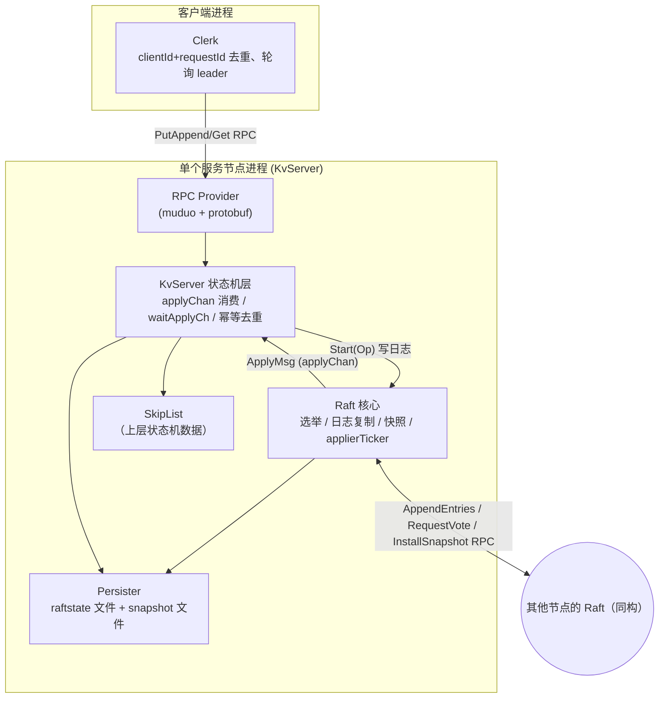
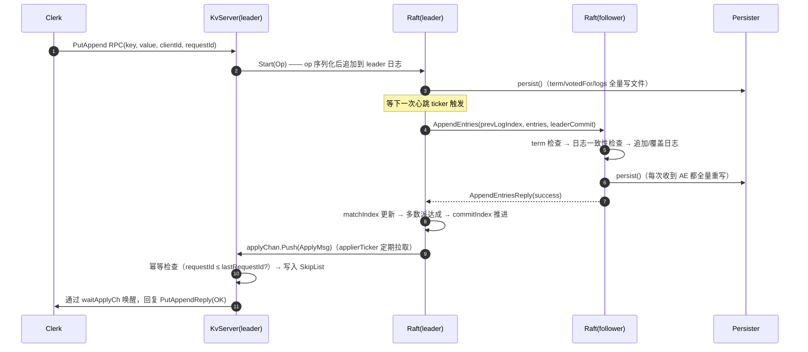

# 分布式存储学习计划（基于 KVstorageBaseRaft-cpp）

> 目标：以 `KVstorageBaseRaft-cpp` 为参考项目，**从零自己重新实现**一个基于 Raft 的分布式 KV 存储系统。
> 本计划给出：参考项目全景解读 → 分阶段实现路线 → 参考项目缺陷与优化清单 → 测试验证体系 → 里程碑。
>
> 建议使用方式：每个阶段先看"要做什么/验收标准"，**闭卷自行设计与实现**，卡住或完成后，再打开参考项目对应源码进行对照。
> 参考代码只是"能跑通的廉价实现"，它存在大量缺陷（见第 4 章），你的目标是写得比它更好。

---

## 目录

1. [参考项目全景解读](#1-参考项目全景解读)
2. [前置知识与参考资料](#2-前置知识与参考资料)
3. [分阶段实现路线（Phase 0 ~ 8）](#3-分阶段实现路线)
4. [参考项目缺陷与优化清单](#4-参考项目缺陷与优化清单)
5. [测试与验证体系](#5-测试与验证体系)
6. [里程碑与时间安排](#6-里程碑与时间安排)
7. [每阶段自查清单（Invariants Checklist）](#7-每阶段自查清单)

---

## 1. 参考项目全景解读

### 1.1 模块地图

参考项目位于 `KVstorageBaseRaft-cpp/`，代码约 7300 行（含自动生成的 pb 文件）。按职责划分为：

| 模块 | 目录 | 职责 | 关键文件 |
|---|---|---|---|
| 公共库 | `src/common` | 工具函数、`Op` 命令定义、`LockQueue` 阻塞队列、日志、`DEFER` | `util.h/cpp`、`config.h` |
| 协程库 | `src/fiber` | 有栈协程 + 调度器 + hook（本项目中仅用于两个定时器） | `iomanager.cpp`、`scheduler.cpp`、`hook.cpp` |
| RPC 框架 | `src/rpc` | 基于 muduo + protobuf 自实现 mprpc：服务注册/反射调用/同步 client | `rpcprovider.cpp`、`mprpcchannel.cpp` |
| 存储引擎 | `src/skipList` | 跳表（状态机的数据存储） | `skipList.h`（header-only） |
| Raft 核心 | `src/raftCore` | 选举、日志复制、持久化、快照、apply 循环 | `raft.cpp`（1121 行，核心中的核心） |
| 状态机层 | `src/raftCore/kvServer` | 消费 applyChan、幂等去重、Get/Put/Append、制作快照 | `kvServer.cpp` |
| 客户端 | `src/raftClerk` | Clerk：clientId+requestId 去重、leader 提示与重试 | `clerk.cpp`、`raftServerRpcUtil.cpp` |
| 协议定义 | `src/raftRpcPro` | raft 节点间协议 + kv 客户端协议 | `raftRPC.proto`、`kvServerRPC.proto` |
| 持久化 | `src/raftCore/Persister` | raft 状态（term/votedFor/log）与快照落盘 | `Persister.cpp` |
| 示例/入口 | `example/raftCoreExample` | 一键 fork 出 N 个节点的入口、客户端 demo | `raftKvDB.cpp`、`caller.cpp` |

### 1.2 系统架构



### 1.3 一次 Put 请求的完整链路（最重要的理解目标）



关键观察（阅读代码时留意这几个"跨界接口"）：

- `Raft::Start(Op, ...)`：状态机 → Raft 的唯一写入入口。
- `LockQueue<ApplyMsg> applyChan`：Raft → 状态机的单向消息通道（快照也走它）。
- `waitApplyCh`（map: raftIndex → 阻塞队列）：apply 完成 → RPC handler 唤醒被阻塞的请求。
- `Persister`：被 Raft 和 KvServer **共用**（同一目录/文件），快照的内容格式由 KvServer 决定，Raft 只负责搬运字节。

### 1.4 核心数据结构速览

| 结构 | 位置 | 说明 |
|---|---|---|
| `Raft` | `raftCore/raft.h` | 全部 Raft 状态：`m_currentTerm / m_votedFor / m_logs / m_commitIndex / m_lastApplied / m_status / m_nextIndex / m_matchIndex / m_lastSnapshotIncludeIndex/Term` |
| `PersistRaftNode` | `raft.h` | boost 序列化载体：term、votedFor、快照下标、logs（每条为 protobuf bytes） |
| `ApplyMsg` | `raftCore/ApplyMsg.h` | CommandValid/Command/CommandIndex 或 SnapshotValid/Snapshot/SnapshotIndex/Term |
| `Op` | `common/util.h` | 状态机命令：Operation(Put/Append/Get)+Key+Value+ClientId+RequestId，以 boost text 序列化 |
| `KvServer` | `raftCore/kvServer.h` | `m_skipList`、`m_lastRequestId`（幂等）、`waitApplyCh`、快照制作 |
| `SkipList<K,V>` | `skipList/skipList.h` | 多层链表 + `SkipListDump`（序列化为两个 vector） |
| `Clerk` | `raftClerk/clerk.h` | `m_clientId`、`m_requestId`（单调递增）、`m_recentLeaderId` |

### 1.5 参考项目运行方式（先把参考项目跑通，再动手写自己的）

依赖：cmake(≥3.22)、g++（C++20）、boost、protobuf、muduo（`lib/` 目录为空，需要自行编译安装 muduo 及其依赖）。

```bash
cd KVstorageBaseRaft-cpp
cmake -B build -S .          # 或 cmake -B cmake-build-debug
cmake --build build -j$(nproc)

# 单机 3 节点（入口进程用 fork 拉起 3 个子进程，端口随机）
./bin/raftCoreRun -n 3 -f test.conf
# 另开终端跑客户端 demo
./bin/callerMain
```

- RPC 入门示例：`example/rpcExample/`（含 `rpc_example.md` 说明）。
- 协程示例：`example/fiberExample/`（如果不想学协程，可以直接忽略整个 `src/fiber` 模块——它只是定时器的实现手段，不是分布式知识本身）。

---

## 2. 前置知识与参考资料

> 原则：**不要等全部学完再动手**。每个阶段只学该阶段需要的，边做边补。

| 主题 | 必须掌握 | 推荐资料 |
|---|---|---|
| Raft 论文 | 全文精读 2~3 遍，能默画 Figure 2 | 《In Search of an Understandable Consensus Algorithm》原文 + raft.github.io 可视化动画 |
| 共识/复制 | 线性一致性概念、状态机复制模型 | MIT 6.824/6.5840 Lecture 笔记；DDIA 第 5/6/9 章 |
| C++ | RAII、mutex/condition_variable、chrono、模板基础、智能指针、`std::function` | cppreference；本项目的 `LockQueue`、`DEFER` 就是很好的 RAII 例子 |
| 网络编程 | TCP 粘包/半包、Reactor 模型 | muduo 网络库源码/《Linux 多线程服务端编程》（可选，也可用自己的 epoll 封装） |
| RPC/序列化 | protobuf 使用、自定义二进制协议（长度前缀） | protobuf 官方 tutorial；本项目 `rpcheader.proto` 协议格式 |
| 数据结构 | 跳表原理（概率平衡） | 本项目 `skipList.h`；Redis zskiplist 设计 |
| 测试方法论 | 故障注入、线性一致性检查 | 6.824 的 tester 设计思想；《Testing Distributed Systems》(Jepsen 系列文章) |

**强烈建议先通读一遍 MIT 6.824 的实验说明（Lab 2/3/4）**——本参考项目的 Raft 实现就是 6.824 风格的移植（甚至保留了大量 Go 注释），但**做完 6.824 的人可以不用做本项目**；如果你不想上课程，就按本计划的路子来。

---

## 3. 分阶段实现路线

> 每个阶段统一结构：**目标 → 任务 → 验收标准 → 常见坑 → 对照参考代码**。
> 建议每个阶段都遵循：设计接口（头文件）→ 写测试 → 实现 → 对照参考项目 → 记录差异。

### Phase 0：环境准备与参考项目跑通（约 5h）

**目标**：能编译、运行参考项目；理解它"长什么样"。

**任务**
1. 安装依赖并把参考项目编译通过、3 节点跑起来、客户端能读写。
2. 精读 README 与 `docs/目录导览.md`，自己画一张架构图（不许照抄第 1 章）。
3. 通读 Raft 论文，整理 Figure 2（所有状态的持久性/易失性表格）到自己的笔记。
4. 读 `src/raftCore/include/raft.h` 接口（**先不看实现**），尝试自己写出每个函数"应该做什么"。

**验收标准**：能向别人讲清楚 1.3 节的完整请求链路；跑 6.824 的 Raft 可视化网站玩一遍选举过程。

---

### Phase 1：基础设施 —— RPC 框架（约 10h）

**目标**：两个进程之间可以互相调用函数（同步 RPC），为 Raft 节点通信与客户端访问打底。

**任务**
1. 定义通信协议：`[4字节长度][RpcHeader{service, method, args_size}][args bytes]`，响应同样加长度前缀（参考项目响应**没有**长度前缀，是个坑）。
2. 实现 `RpcProvider`：服务注册（service → method → handler）、连接管理、消息解析、通过 protobuf 反射 `CallMethod` 分发。
3. 实现 `MprpcChannel`（客户端 stub 的统一入口）：序列化请求、发送、按长度前缀完整收包、反序列化响应。
4. 实现 `MprpcController`（承载错误信息）。
5. 用 protobuf 定义两个 service 做验证（如 `EchoService.Call`），编写独立 client/server 进程测试。

**验收标准**
- 两个独立进程间调用成功；连续 1 万次调用无粘包/半包错误。
- **大消息（>1MB）正确传输**（考验长度前缀与完整收包逻辑）。
- 断连后 client 能自动重连。
- 并发调用同一 channel 不会串包（或明确文档化"每 channel 单线程使用"）。

**常见坑**
- 只调一次 `send`/`recv` 就假设数据完整（TCP 是字节流！）。
- 响应不带长度前缀，靠"一次 recv 拿完整包"——小消息在 loopback 上碰巧能跑，线上必炸。
- 多线程共享一个 fd 交错收发。
- 服务端对每个连接读缓冲区残留数据的处理（本项目用 `retrieveAllAsString` 粗暴清空，多请求粘连会丢）。

**对照参考代码**：`src/rpc/rpcprovider.cpp`、`src/rpc/mprpcchannel.cpp`、`src/rpc/rpcheader.proto`；`src/raftCore/raftRpcUtil.h`（Raft 对 RPC 的封装层）。

---

### Phase 2：存储引擎 —— 跳表（约 6h）

**目标**：实现一个支持增删改查 + 快照序列化/恢复的 KV 内存引擎。

**任务**
1. 实现 `SkipList<K,V>`：insert / search / delete / update、随机层高、最大层限制。
2. 实现 `dump()`（遍历成有序 key/value 数组并序列化）与 `load()`（反序列化并重建）。
3. （可选替换）用 `std::unordered_map` 或 leveldb 实现同样的接口，体会"状态机与存储引擎解耦"。

**验收标准**
- 与 `std::map` 对拍：随机 10 万次操作结果一致。
- dump → load 后数据**完全一致（尤其 value 不能错）**——参考项目正是在这里有一个致命 bug（把 key 当 value 插入，见 4.1 A4）。
- 单线程性能基线：插入/查询 10 万条 < 1s（关闭所有打印！）。

**常见坑**
- 快照恢复用 `insert(key, value)` 时参数写错；恢复顺序/重复 key 处理。
- 每次操作 `std::cout` 打印（参考项目就这么干的，压测时是灾难）。
- 递归析构在大数据量下爆栈。

**对照参考代码**：`src/skipList/include/skipList.h`。

---

### Phase 3：Raft（2A）—— 领导人选举（约 12h）

**目标**：N 个节点在无 leader 时自动选出唯一 leader，且能自动处理宕机/恢复。

**任务**
1. 设计 `Raft` 类接口：`Start`、`GetState`、三个 RPC handler、定时器、`applyChan`。
2. 与真实 RPC 解耦：**先写一个内存版测试器**（模拟网络：可丢包、延迟、分区、节点重启），这是 6.824 的核心思想，强烈推荐。
3. 实现：选举超时随机化、`Candidate` 状态转换、RequestVote、心跳、term 规则（任何 RPC 见到更大 term 就降级 follower 并更新 term/votedFor）。
4. 实现 `Persister`（本阶段先落 term/votedFor）。

**验收标准**（用自写的随机测试器反复跑 1000 轮）
- 任意时刻至多一个 leader（同一 term 内）。
- 断线/宕机节点恢复后不会破坏上面的性质。
- 5 节点允许 2 个宕机仍能选出 leader。

**常见坑**
- 选举超时没有随机化 → 永远平票。
- 收到旧 term RPC 时错误地重置选举定时器（参考项目注释里专门提醒了这点）。
- term/votedFor 未持久化就投票 → 重启后重复投票（可能双主）。
- 平票后重试时忘记 `currentTerm++`。

**对照参考代码**：`raft.cpp` 的 `doElection / sendRequestVote / RequestVote / electionTimeOutTicker / doHeartBeat（空壳版）`；`Persister.cpp`。

---

### Phase 4：Raft（2B）—— 日志复制（约 15h）

**目标**：`Start()` 写入的命令在多数派确认后提交，并 apply 到上层；任意日志冲突都能收敛。

**任务**
1. 实现 `AppendEntries`：term 检查 → prevLogIndex/Term 一致性检查 → 截断/追加 → 更新 commitIndex（受 leaderCommit 与自身 lastLogIndex 约束）。
2. 实现 leader 侧：`nextIndex/matchIndex` 维护、成功后推 `commitIndex`（**只能提交当前 term 的日志**）、失败回退优化（按 term 跳跃而非逐条 -1）。
3. 实现 `applierTicker`：把 `[lastApplied+1, commitIndex]` 转为 `ApplyMsg` 推给状态机。
4. 扩展测试器：随机丢消息、乱序、分区、随机 kill 节点并重启。

**验收标准**
- 随机故障序列下，所有存活节点最终日志收敛一致。
- 任意时刻已 apply 的命令序列在各节点前缀一致（Log Matching + State Machine Safety）。
- 专门构造论文 Figure 8 场景验证"只提交当前 term 日志"规则。

**常见坑**
- 无脑截断日志（应逐条比较 index+term，相同 index+term 的条目视为相同，不能覆盖）。
- commitIndex = min(leaderCommit, lastLogIndex) 写错导致 apply 不存在的日志。
- 忘记"leader 只有当前 term 有新日志提交时才推进 commitIndex"。
- 心跳与日志复制分离后，心跳不携带日志时忘了也推进 follower 的 commitIndex。

**对照参考代码**：`raft.cpp` 的 `AppendEntries1 / sendAppendEntries / leaderUpdateCommitIndex / getApplyLogs / Start`。

---

### Phase 5：Raft（2C）—— 持久化（约 8h）

**目标**：任意时刻 `kill -9`，重启后不违反任何安全性性质（不重复投票、不丢已提交日志）。

**任务**
1. 设计持久化格式：term、votedFor、log[]、（快照元数据）。推荐**二进制 protobuf 或自定义二进制**，不要用人类可读文本（体积/速度）。
2. 实现正确的落盘：写临时文件 → `fsync` → `rename` 原子替换；或 WAL + 定期 compact。
3. 启动流程：加载持久化状态 → 恢复 `commitIndex/lastApplied`（可通过快照元数据）→ 再开放 RPC。
4. 回归 2A/2B 的所有随机测试 + 增加"任意时刻崩溃重启"注入。

**验收标准**
- 随机 kill -9 后重启，所有 2A/2B 性质依然成立。
- 文件不含半写内容（原子替换的验证：kill 在写盘中途也不会损坏）。

**常见坑**（参考项目在这块几乎全踩了，详见 4.1 A1~A3）
- 启动时清空/截断持久化文件 → 恢复永远失效。
- 用 `>>` 读回多 token 的序列化字符串（遇空格截断）。
- 写后不 flush/fsync、无原子替换。
- 持久化时机错误：投票前、日志变更后、term 变更后**都必须**先落盘再用。

**对照参考代码**：`Persister.cpp`、`raft.cpp` 的 `persist/readPersist/persistData`（**注意：它是有 bug 的，不要照抄**）。

---

### Phase 6：Raft（2D）—— 快照与日志压缩（约 12h）

**目标**：日志无限增长时能压缩；落后太多/新加入的节点通过 InstallSnapshot 追赶。

**任务**
1. Raft 侧：`Snapshot(index, snapshotBytes)`（状态机通知后截断日志、记录 lastIncludedIndex/Term）、`InstallSnapshot` handler、leader 在 `nextIndex ≤ lastIncludeIndex` 时改发快照。
2. 状态机侧：按阈值（如 raft state 大小 / 日志条数）制作快照 = 序列化（KV 数据 + lastRequestId）；收到快照消息时恢复。
3. 快照传输优化（进阶）：分块传输 + offset 续传 + 流控，防止大快照打爆内存/消息。
4. 日志下标体系重构：明确"逻辑 index"与"内存数组下标"的换算（参考项目用 `getSlicesIndexFromLogIndex` 硬编码换算，到处是断言，很容易越界）。

**验收标准**
- 快照后重启能完整恢复（**注意 value 正确性**）；日志被截断（文件大小不再增长）。
- 落后节点/被清空日志的节点通过快照追上。
- 快照安装与 apply 循环不会重复 apply 或跳过 apply（CondInstallSnapshot 语义要想清楚）。

**常见坑**
- 快照边界：lastIncludedIndex/Term、日志截断、commitIndex/lastApplied 的更新顺序。
- 快照安装后的重复 apply（应保证幂等或严格判断）。
- leader 发送快照期间状态变化（term 变化、不再是 leader）要按 term 检查处理。

**对照参考代码**：`raft.cpp` 的 `Snapshot/InstallSnapshot/leaderSendSnapShot/CondInstallSnapshot`；`kvServer.cpp` 的 `MakeSnapShot/GetSnapShotFromRaft/ReadSnapShotToInstall`；`kvServer.h` 的序列化私有方法。

---

### Phase 7：状态机层 + 客户端 —— 线性一致性 KV（约 12h）

**目标**：对外表现为"一个单机 KV，读你的写"（线性一致性），节点故障对客户端透明。

**任务**
1. `KvServer`：`ReadRaftApplyCommandLoop` 消费 applyChan → 幂等去重（clientId+requestId）→ 执行到 SkipList → 唤醒 `waitApplyCh` 中阻塞的请求。
2. 三个 RPC：`Get / Put / Append`（经 Raft 提交）；非 leader 返回 `ErrWrongLeader` 让客户端换节点。
3. `Clerk`：`clientId`（随机 UUID）+ 递增 `requestId`；同一请求重试时 **requestId 不变**（服务端去重保证幂等）；缓存 recentLeader 加速重试。
4. 处理"超时后请求可能已提交"的问题：超时重试时依赖服务端去重语义（参考项目用 `ifRequestDuplicate`）。

**验收标准**
- 并发多客户端 + 随机杀 leader 的随机测试下：无已确认写丢失、无重复执行（Append 不重复追加）、读能读到最新已提交写。
- 模拟整个集群重启后数据完好。

**常见坑**
- 重试时更换 requestId → 去重失效 → Append 重复执行。
- 幂等检查判等错误（应 `requestId ≤ lastRequestId[client]` 为重复，因客户端串行递增）。
- 快照恢复后 `lastRequestId` 丢失 → 重复执行。
- leader 变更后旧 leader 对新请求立即拒绝的时机（防止"不知自己已被取代"长期阻塞请求）。

**对照参考代码**：`kvServer.cpp`、`clerk.cpp`、`raftCore/kvServer.h`。

---

### Phase 8：工程化与进阶优化（持续，约 20h+）

**目标**：从"课程作业级"走向"能讲清楚、有数据支撑"的项目。

按收益排序的建议方向（详细见第 4 章缺陷清单）：

1. **启动/配置工程化**：去掉 sleep 协调；配置文件 + 重试连接；优雅退出（信号处理、资源回收）。
2. **性能优化**：
   - GET 走 ReadIndex（不写日志），随后可加 LeaseRead；
   - 日志复制批量/流水线，`nextIndex` 一次可发多条或整段；
   - follower 持久化只在日志/term/vote 变化时进行（不要每次心跳全量重写）；
   - 二进制序列化（protobuf/自有格式）替代 boost text；
   - 连接复用 + 请求响应关联（多路复用）或连接池；
   - 移除"每请求一线程"，使用线程池/epoll 异步化。
3. **可观测性**：metrics（QPS、延迟、选举次数、日志 lag）、结构化日志、Debug 开关。
4. **正确性加固**：TSan/ASan 清零、单元测试与 CI、随机故障注入常态化。
5. **功能进阶**（选做，简历亮点）：
   - ReadIndex/LeaseRead、follower read；
   - 集群成员变更（joint consensus / 单步变更）；
   - 快照分块与流控；
   - 客户端批量/异步 API、超时退避；
   - Multi-Raft + 分片（类 TiKV 架构）；
   - WAL + LSM/多版本存储引擎替换跳表。

---

## 4. 参考项目缺陷与优化清单

> 说明：以下缺陷是我逐文件阅读后整理的（不含自动生成的 pb 代码）。
> **学习价值极高**——每一项都可以反过来当作你自己的"设计 check list"。

### 4.1 正确性与安全性（严重，必须避免重蹈覆辙）

| # | 位置 | 问题 | 影响 | 修复建议 |
|---|---|---|---|---|
| A1 | `Persister.cpp` 构造函数 | 启动时以 `trunc` 打开 raftstate/snapshot 文件，**立即清空** | 崩溃恢复功能实际完全失效（每次重启都是空状态） | 启动只读，不 truncate；只在首次创建时初始化 |
| A2 | `Persister.cpp` `ReadRaftState/ReadSnapshot` | 用 `ifs >> snapshot` 读取：`operator>>` 遇空白符截断，而 boost text archive 含大量空格 | 即使 A1 修复，读回的数据也几乎必然不完整/解析失败 | 用 `std::getline` / `read` 读全长，或二进制格式 + 长度前缀 |
| A3 | `Persister.cpp` `Save/SaveRaftState` | 写后不 flush/fsync，无原子替换（直接覆盖写文件） | 掉电/崩溃可能丢失已确认数据或产生半写文件 | 临时文件 + fsync + rename；或 WAL |
| A4 | `skipList.h` `load_file` | `insert_element(keyDumpVt_[i], keyDumpVt_[i])` —— **把 key 当 value 插入** | 快照恢复后所有 value 变成 key，数据损坏 | 改为 `insert_element(keyDumpVt_[i], valDumpVt_[i])` |
| A5 | `raft.cpp` `AppendEntries1` | `prevlogindex < m_lastSnapshotIncludeIndex` 分支**缺少 `return`**（被注释掉） | 会继续执行 `matchLog` 触发断言，进程直接退出 | 补上 return（返回让 leader 回退 nextIndex） |
| A6 | `raft.cpp` `sendAppendEntries` | 收到更高 term 后更新 term/votedFor 但**没有 persist()** | 崩溃重启后可能在同一 term 重复投票，违反 Election Safety | 状态变更即落盘（对比 `leaderSendSnapShot` 里是有 persist 的） |
| A7 | `raft.cpp` `CondInstallSnapshot` | 无条件 `return true`（6.824 的填空残留） | 快照安装与 commitIndex/lastApplied/logs 截断的协同不严谨，可重复/漏 apply | 按论文语义判断过期与否，并与 apply 循环互斥协调 |
| A8 | `mprpcchannel.cpp` | 客户端 `recv` 使用固定 1024 字节缓冲区且**无长度前缀**；`send` 不处理部分写 | 响应 >1KB 被截断解析失败；大日志 AE 部分写导致协议流损坏 | 协议加长度前缀；循环收发直到完整 |
| A9 | `mprpcchannel.cpp` | 一个 channel 一个 fd，无并发保护、无请求-响应关联；而 Raft 对同一 peer 会有并发调用（心跳线程 + 快照线程 + 多轮心跳重叠） | 并发调用串包：快照回复可能被当成心跳回复处理，状态错乱 | 加锁串行化、或实现请求 ID + 多路复用、或连接池 |
| A10 | `raft.cpp` `leaderHearBeatTicker/electionTimeOutTicker` | `m_status`、`m_lastResetHearBeatTime` 在锁外读取；无 atomic/无同步 | 数据竞争（TSan 可抓）、行为未定义 | 全部通过锁访问或用 atomic + 条件变量 |
| A11 | 多处日志 | `DPrintf` 用 `%s/%d` 传递 `std::string*`、`Op*` 等（如 `&op.Key`、`&command`），`%v` 非法格式符 | 未定义行为、输出乱码 | 使用类型安全日志（格式化库或封装） |
| A12 | `util.cpp` `myAssert` | 断言失败直接 `std::exit` | 生产不可用；误触发即整节点退出（A5 的放大器） | 分级：测试用 assert，生产用错误处理/降级 |
| A13 | `kvServer.cpp` `Get` 超时路径 | 超时后检查 `ifRequestDuplicate && isLeader` 再本地读——检查与执行之间存在 leader 变更窗口 | 边界情况下可能违反线性一致性的论证不严谨 | 用 ReadIndex 方案或严格单线程状态机校验 |
| A14 | `kvServer.cpp` `waitApplyCh` 管理 | 裸 `new/delete LockQueue`，超时清理与 apply 推送并发交错 | 偶发消息丢失/悬垂指针风险 | `shared_ptr` + 明确生命周期协议 |
| A15 | `raft.cpp` 全局 | 大量 `todo`/注释代码残留（如 `CondInstallSnapshot`、`leaderUpdateCommitIndex` 未被使用） | 可维护性差、误导读者 | 清理死代码，保持唯一实现路径 |

### 4.2 性能问题（优化方向清单）

| # | 位置 | 问题 | 优化方向 |
|---|---|---|---|
| B1 | `raft.cpp` `AppendEntries1` 的 `DEFER { persist(); }` | follower 每收到一次心跳（无新日志）也全量序列化重写整个日志 | 仅在 term/votedFor/logs 变化时持久化；日志追加写（WAL）；二进制格式 |
| B2 | `raft.cpp` `doHeartBeat` | 每次心跳把 `nextIndex → lastLogIndex` 的**全部日志**塞进一个消息发送，无批量上限 | 限制单批条数/字节数；流水线发送；区分心跳与复制 |
| B3 | `raft.cpp` `doElection/doHeartBeat/leaderSendSnapShot` | 每个 peer、每轮心跳都 `std::thread(...).detach()` | 线程池或异步 IO；固定线程 + 任务队列 |
| B4 | `config.h` + `util.cpp` | `Debug=true` 全局打印；跳表每次 insert/search 都 `std::cout`；`DprintfKVDB` 每次操作 dump 全表 | 日志分级、异步日志；压测时全关 |
| B5 | `kvServer.cpp` `Get` | 读请求也走 Raft 日志（每个 GET 写一条日志 + 一次持久化 + 一轮复制） | ReadIndex/LeaseRead：读不落日志；或批处理读 |
| B6 | `util.h` `Op`、`raft.cpp` `persistData` | 全用 boost text 序列化（体积大、速度慢、含空格还引发 A2） | protobuf 二进制或自定义紧凑格式 |
| B7 | `raft.cpp` `applierTicker` | 固定 10ms 轮询 + 每轮单独唤醒 QvServer | 提交后立即异步通知（条件变量/事件驱动） |
| B8 | `skipList.h` | `insert_set_element` = search + delete + insert（两次遍历+打印）；无内存池；递归析构 | 一次遍历完成 set；对象池/arena；迭代式析构 |
| B9 | RPC 层 | 同步阻塞 send+recv，单连接无批处理；心跳固定 25ms、选举 300~500ms 硬编码 | 异步 RPC + 批处理 + 自适应心跳 |
| B10 | 整体 | muduo(4线程) + fiber(1线程) + 每请求新线程 + detached 线程混杂 | 统一并发模型，减少线程创建与上下文切换 |

### 4.3 工程与架构问题

| # | 问题 | 说明 | 改进 |
|---|---|---|---|
| C1 | 启动同步靠 `sleep(6)` 与 `sleep(N-me)` | 时序脆弱，机器慢/快都可能挂 | 重试连接 + 就绪探测（握手 RPC）；或注册中心 |
| C2 | `RpcProvider::Run` 运行时向 `test.conf` **追加写**节点信息 | 多进程写竞争、重复行（当前 `bin/test.conf` 已可见 `node1` 重复）、文件名硬编码 | 启动前由部署脚本生成静态配置；节点只读 |
| C3 | 配置硬编码 | 端口段、`maxRaftState=500`、超时、文件路径散落各处 | 统一配置文件（yaml/toml/命令行） |
| C4 | CMake 全局 `include_directories` + 跨目录源文件变量拼库 | 路径污染（作者自己注释里也承认）；改动即连锁 | 每个子模块用 `target_include_directories/target_link_libraries` |
| C5 | `fork()` 单机拉起 N 节点 | 仅本地测试手段，进程共用 `test.conf`、随机端口可能冲突 | 部署脚本/容器化（每节点独立进程与目录） |
| C6 | 为两个定时器引入完整有栈协程库 + 全局 hook | 复杂度收益比低；hook 与 muduo IO 线程共存有潜在风险 | 定时器用条件变量/时间轮即可；或明确隔离协程线程 |
| C7 | 无优雅退出 | detached 线程 + 裸 new/delete + 无信号处理，进程退出状态不确定 | RAII、信号处理、join/停止标志 |
| C8 | 错误处理粗糙 | 异常未捕获（boost archive 解析失败会直接 terminate）、`myAssert` 退出、错误路径大量 `todo` | 明确错误边界与降级策略 |
| C9 | 无单元测试/CI/脚本 | 只有手写 main 示例 | gtest/doctest + ctest + 随机故障测试脚本 |
| C10 | 无监控 | 无指标无结构化日志 | Prometheus 指标 + 日志分级 |
| C11 | 内存管理 | `RaftRpcUtil*`、`MprpcChannel*` 等裸指针所有权混乱 | `unique_ptr/shared_ptr` 明确所有权 |

### 4.4 功能缺失（可作为进阶/简历亮点）

| # | 缺失功能 | 价值 |
|---|---|---|
| D1 | 集群成员变更（Joint Consensus / 单节点变更） | 高（论文第 6 章，面试常考） |
| D2 | 快照分块传输、增量快照、流控 | 高（大状态生产必备） |
| D3 | ReadIndex / LeaseRead / Follower Read | 高（读性能数量级提升） |
| D4 | 日志复制流水线与批处理参数化 | 中（吞吐提升） |
| D5 | 可替换存储引擎（WAL + LSM / RocksDB） | 中（结合"存储"主题） |
| D6 | 事务/多版本/TTL/范围查询 | 中（向数据库演进） |
| D7 | 鉴权、TLS、压缩（snapshot/log 压缩） | 中 |
| D8 | 客户端批量、异步 API、退避重试、请求缓存 | 中 |
| D9 | Multi-Raft 分片（region 调度，类 TiKV） | 高（架构级亮点） |
| D10 | 混沌测试工具、线性一致性检查器（Porcupine 思路） | 高（"证明正确"比"说正确"值钱） |

---

## 5. 测试与验证体系

> 分布式系统的正确性靠"测"出来，你未来的简历答辩与面试都会围绕"你怎么证明它对"。

### 5.1 分层测试策略

| 层级 | 方法 | 说明 |
|---|---|---|
| 单元测试 | gtest/doctest | 跳表、持久化格式、RPC 编解码、日志下标换算工具函数 |
| 模拟器测试（核心！） | 自写"内存网络"测试器：节点间消息可延迟/丢失/乱序/分区，节点可随机启停 | 不依赖真实网络即可跑上万轮随机场景；参考 6.824 tester 思想 |
| 集成测试 | 真实多进程 3/5 节点 + 脚本化故障注入 | `kill -9` 随机节点、`kill -STOP/CONT` 模拟假死/网络分区 |
| 一致性测试 | 并发客户端 + 故障注入 + 历史检查 | 可自写线性一致性检查器或借鉴 Porcupine/Jepsen 思路 |
| 性能测试 | 关 Debug 日志，测 QPS / P50 / P99 / 恢复时间 | 对比优化前后（如 Get 走日志 vs ReadIndex） |

### 5.2 关键随机测试场景（每阶段都要回归）

1. **选举风暴**：随机启停节点 1000 轮，断言任意时刻每 term 最多一个 leader（记录所有节点的 (term, leaderId) 历史）。
2. **日志收敛**：随机提交命令 + 随机消息丢失/延迟，最终所有存活节点日志一致。
3. **崩溃恢复**：随机时刻 `kill -9` → 重启，断言不丢已提交数据。
4. **分区恢复**：少数派分区 → 恢复 → 落后节点自动追平（快照 + 日志）。
5. **快照链路**：小阈值触发频繁快照，跑上述所有场景。
6. **线性一致性**：多客户端并发 Put/Append/Get，注入故障，校验"读到的值 = 最后一次已确认写"的线性化历史。

### 5.3 工具清单

- **Sanitizer 必开**：`-fsanitize=thread`（抓数据竞争，参考项目里一堆）、`-fsanitize=address,undefined`。
- gdb / core dump 分析；`perf` 做火焰图；`valgrind --tool=helgrind` 辅助。
- 日志：每节点独立日志文件，带 term/角色/事件编号，便于事后回放。
- CI（GitHub Actions）：编译 + 单测 + 短随机测试。

---

## 6. 里程碑与时间安排

> 以"工作日晚上 + 周末"约 **10~15h/周** 估算；可按自己节奏缩放。

| 阶段 | 内容 | 预估 | 里程碑产出 |
|---|---|---|---|
| M0 | Phase 0 跑通参考项目 + 读论文 | 5h | 架构图、论文笔记 |
| M1 | Phase 1 RPC 框架 | 10h | 进程间 RPC demo、大消息/重连测试通过 |
| M2 | Phase 2 跳表 | 6h | 单测 + dump/load 对拍通过 |
| M3 | Phase 3 Raft 2A | 12h | 内存模拟器 1000 轮选举通过 |
| M4 | Phase 4 Raft 2B | 15h | 随机故障下日志一致性通过 |
| M5 | Phase 5 Raft 2C | 8h | kill -9 崩溃恢复测试通过 |
| M6 | Phase 6 Raft 2D | 12h | 快照压缩 + 落后追赶测试通过 |
| M7 | Phase 7 KV + Clerk | 12h | 并发线性一致性（含故障注入）通过 |
| M8 | Phase 8 工程化/优化（可选 1~2 项深做） | 20h+ | 性能报告 + 至少 1 个进阶功能 |

**总计约 100h**（不含 M8 的深度优化）。如果时间紧张：优先保证 M3~M7 的**正确性**，再谈 M8 优化。

**通过标志**：你能用自己写的测试脚本，在一次运行里完成"起 5 节点 → 压测 → 随机杀 2 个节点 → 恢复 → 数据校验"，且连续跑 10 轮全绿。

---

## 7. 每阶段自查清单

### Raft 五大安全性 Invariants（最终交付前逐条自查）

- [ ] **Election Safety**：每个 term 至多一个 leader（且 vote 状态持久化正确）。
- [ ] **Leader Append-Only**：leader 从不覆盖/删除自己的日志，只追加。
- [ ] **Log Matching**：两个日志在相同 index 处 term 相同 ⇒ 该位置及之前所有条目完全相同（含 AppendEntries 一致性检查的实现正确性）。
- [ ] **Leader Completeness**：commit 过的日志必然存在于所有更高 term 的 leader 中（选举限制 `UpToDate` 实现正确）。
- [ ] **State Machine Safety**：任一 index 不会被 apply 成不同命令（含快照路径不重复/不漏 apply）。

### 工程自查

- [ ] 关闭 Debug 开关后无任何逐请求打印。
- [ ] TSan/ASan 在随机测试下零报告。
- [ ] 任意进程 kill -9 后重启，系统能恢复到一致状态。
- [ ] 无硬编码 sleep 的启动协调；节点启动顺序无关。
- [ ] 所有资源（线程/连接/内存）有明确所有权与回收路径。
- [ ] README 能说清：架构图、启动方式、压测数据、已做优化与下一步计划。

---

## 附录 A：推荐的学习顺序与参考项目文件对照速查

| 你要实现的模块 | 先读接口（不看实现） | 对照实现的文件 |
|---|---|---|
| RPC 框架 | `src/rpc/include/*.h` | `rpcprovider.cpp` / `mprpcchannel.cpp` |
| 协议 | `examples/rpcExample/friend.proto` | `src/raftRpcPro/*.proto` |
| 跳表 | `src/skipList/include/skipList.h`（类声明部分） | 同文件实现部分 |
| Raft | `src/raftCore/include/raft.h` | `raft.cpp`（按函数逐个对照） |
| 持久化 | `src/raftCore/include/Persister.h` | `Persister.cpp` |
| 状态机 | `src/raftCore/include/kvServer.h` | `kvServer.cpp` |
| 客户端 | `src/raftClerk/include/clerk.h` | `clerk.cpp` |
| 组装启动 | `example/raftCoreExample/raftKvDB.cpp` | 同文件 |

## 附录 B：一句话记住本项目的核心数据流

> **Clerk --RPC--> KvServer --Start(Op)--> Raft log --AppendEntries 复制--> 多数派 --persist--> commitIndex --applierTicker--> ApplyMsg --applyChan--> KvServer --幂等执行--> SkipList --waitApplyCh--> 回复 Clerk**

Raft 保证的是：**所有节点以相同的顺序执行相同的命令**；上层只要做到"确定性 + 幂等"，整个系统就具备了线性一致性。
